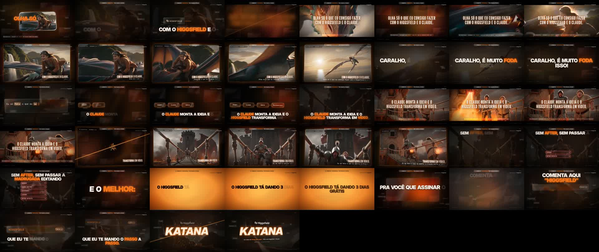

# Higgsfield Motion

Skill do Claude Code para criar vídeos de motion no estilo do vídeo **Higgsfield + Claude** do Victor Dias ([@diasl_uisvictor](https://instagram.com/diasl_uisvictor)), feito em parceria com a [Higgsfield](https://higgsfield.ai).



Todas as cenas do vídeo de referência foram geradas **aqui dentro do Claude**, com o conector do Higgsfield (Seedance 2.0). Você grava a narração, pede as cenas para o Claude, e ele monta o resto: texto cinético com a sua fala palavra por palavra, interface em vidro, as cenas entrando em tela cheia e virando card de vidro, laser cortando a tela, logo com corte de lâmina, trilha 3D, um efeito sonoro para cada coisa que acontece na tela, digitação em cada palavra, capa e legenda para o Instagram.

## Gere as cenas dentro do Claude: conector do Higgsfield

Foi assim que eu fiz: sem abrir outro site, o Claude escreve o prompt de cada cena e gera o vídeo no Higgsfield pelo conector.

1. No [claude.ai](https://claude.ai), abra **Configurações → Conectores**.
2. Procure **Higgsfield** e clique em **Conectar**. Entre com a sua conta do Higgsfield (ou crie uma) e autorize.
3. Pronto: o conector vale no chat e no Claude Code. É só pedir, por exemplo: *"gera no Higgsfield, com o Seedance 2.0, uma cena de 5 s em 16:9 de um dragão rugindo para a câmera"*.

### Prompts que eu usei

Os 4 prompts das cenas do vídeo (dragão, voando no dragão, cavaleiros queimados e cavaleiros na ponte) estão em [references/prompts.md](references/prompts.md), prontos para copiar. É só colar no Claude com o conector ligado: *"gera isso no Higgsfield com o Seedance 2.0, 16:9"*.

### 🎁 3 dias grátis no Higgsfield

O Higgsfield está dando **3 dias grátis** para quem assina o Claude. Comenta **"HIGGSFIELD"** no meu post do Instagram ([@diasl_uisvictor](https://instagram.com/diasl_uisvictor)) que eu te mando o passo a passo para ativar.

## O que vem junto

- **Modelo da animação** (`assets/modelo/`): o motor do vídeo de referência, pronto para trocar texto, cenas e marca.
- **Som**: trilha limpa girando em 3D, mapa visual do vídeo, efeitos automáticos (cortes, cenas, laser, logo e um toque de digitação por palavra) e mix final em -14 LUFS.
- **Sons CC0** (`assets/sons_cc0/`): whooshes, risers, impactos suaves, teclas, cliques e sons de cena (vento, rugido, asas, fogo, passos), todos de uso livre. Licenças em `LICENSES_katana.txt` e, para as gravações do Freesound, CC0.
- **Capa e legenda** para Reels (`assets/capa/`).
- **Tudo o que foi aprovado e reprovado** no vídeo de referência (`references/`).

## O que você precisa

- Claude Code no computador (o chat comum não renderiza vídeo).
- Narração em áudio e o texto dela, e a sua música.
- O conector do Higgsfield ligado no Claude para gerar as cenas (ou os clipes que você já gerou no Higgsfield).
- Python 3, FFmpeg, Node e Playwright. A skill confere e pede um "sim" para instalar o que faltar.

## Como instalar

Abra o Claude Code e cole:

```
Instala esta skill para mim: https://github.com/jislan1220-ux/higgsfield-motion.git na pasta ~/.claude/skills/higgsfield-motion
```

Depois é só pedir: *"faz um vídeo no estilo Higgsfield Motion com esta narração"*. Com o conector ligado, o Claude sugere as cenas, gera no Higgsfield e monta o vídeo.

## Aviso

Skill independente, feita pelo Victor Dias. Não é um produto oficial da Higgsfield. Os sons de pacotes pagos usados no vídeo original não estão aqui; use os sons CC0 que vêm junto ou os seus.
